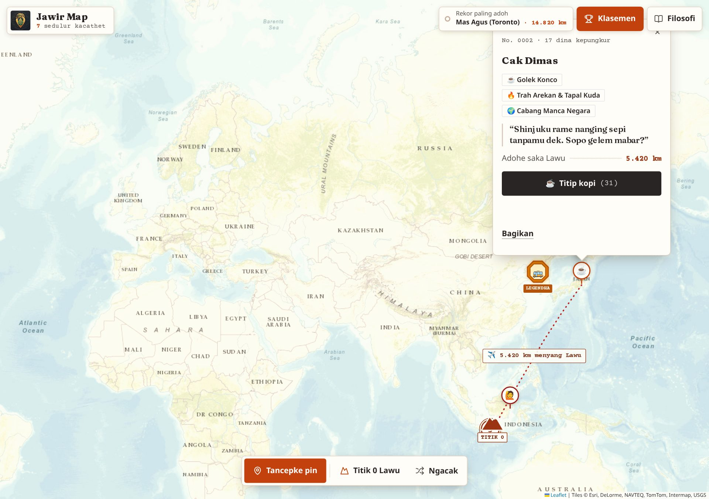
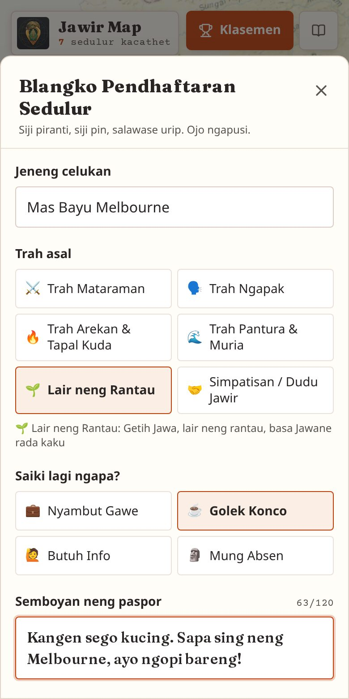
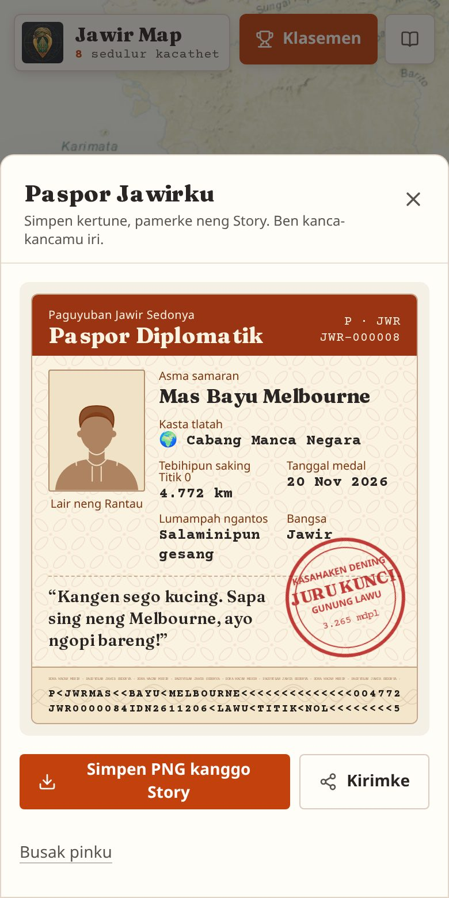
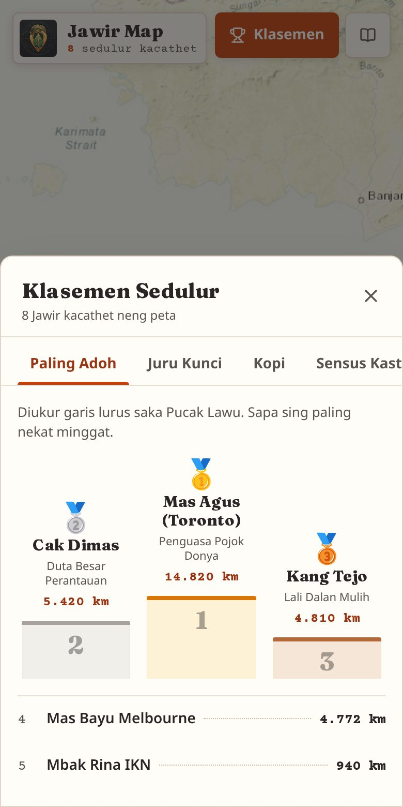
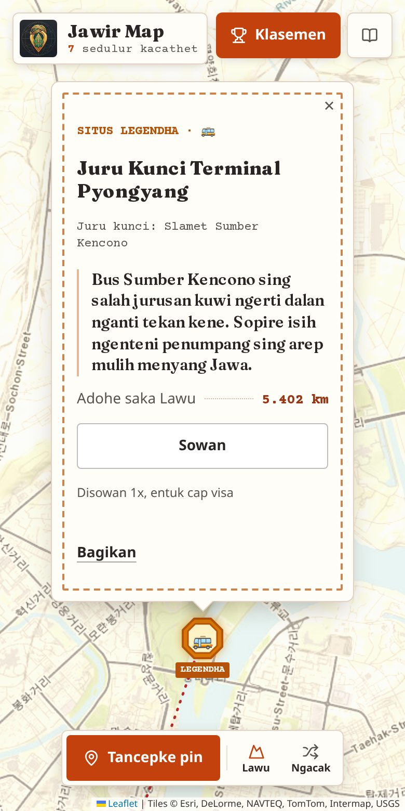

# Jawir Map

**Peta Sedulur Jawir Sedonya.** Sedulur Jawa ada di mana-mana: di Toronto, Shinjuku, IKN, sampai kos-kosan di Jaksel. Jawir Map mengumpulkan mereka di satu peta dunia. Tancapkan satu pin, dapatkan Paspor Jawir, dan lihat seberapa jauh kamu dari Titik 0 di Puncak Gunung Lawu.

**👉 [jawirmap.lumelo.my.id](https://jawirmap.lumelo.my.id)**

## Kenapa Lawu?

Gunung Lawu (3.265 mdpl) berdiri tepat di perbatasan Karanganyar (Jateng) dan Magetan (Jatim). Jaraknya ke sedulur Ngapak di barat dan ke sedulur Arekan di timur kurang lebih sama. Lawu juga dikenal sebagai petilasan Prabu Brawijaya V, jembatan cerita dari Majapahit ke Mataram.

Karena itu Lawu jadi **Titik 0**. Setiap pin di peta ditarik benang merah ke puncaknya, dan jarak setiap Jawir dihitung dari sana.

## Cara main

1. **Tancepke pin.** Isi nama panggilan, pilih trah asal dan sedang ngapain, lalu tulis semboyan singkat. Lokasi bisa diambil dari GPS atau dipilih langsung di peta.
2. **Terima Paspor Jawir.** Paspor Diplomatik digital langsung terbit, lengkap dengan nomor urut Jawir, kasta wilayah, jarak dari Lawu, cap Juru Kunci Gunung Lawu, dan kode MRZ ala paspor sungguhan. Simpan sebagai PNG untuk Story.
3. **Pamerkan.** Bagikan link pinmu. Di WhatsApp, X, dan Telegram link itu muncul sebagai kartu paspor lengkap dengan nama, semboyan, dan jarakmu.
4. **Jelajahi.** Klik pin sedulur lain untuk membaca semboyannya dan melihat rute benang merahnya ke Lawu. Bisa juga terbang ke rekor paling jauh, atau tekan **Ngacak** untuk mampir ke Jawir acak.

<table>
  <tr>
    <td align="center"></td>
    <td align="center"></td>
    <td align="center"></td>
    <td align="center"></td>
  </tr>
  <tr>
    <td align="center">Blangko pendaftaran</td>
    <td align="center">Paspor Jawir</td>
    <td align="center">Klasemen</td>
    <td align="center">Situs Legendha</td>
  </tr>
</table>

Begini tampilan link pin saat dibagikan ke WhatsApp, X, atau Telegram:

## Isi peta

**Kasta wilayah**, ditentukan otomatis dari lokasi pin:

| Kasta | Wilayah |
| --- | --- |
| 🏠 Jawir Kandang | Jateng, DIY, Jatim, Madura. Mulih cukup numpak bis. |
| 🏕️ Rantau Lv.1 (Sunda Empire) | Jabar, Banten, Jabodetabek. Wis wani adoh saka sambel bawang. |
| ⛴️ Rantau Nyabrang Pulo | Sumatra, Kalimantan, Sulawesi, Bali, sampai Papua. |
| 🌍 Cabang Manca Negara | Luar negeri. Mulih kudu nabung setaun. |

**Trah asal:** ⚔️ Mataraman, 🗣️ Ngapak, 🔥 Arekan & Tapal Kuda, 🌊 Pantura & Muria, 🌱 Lair neng Rantau, dan 🤝 Simpatisan (bukan Jawa, tapi sudah doyan sambal).

**Sedang ngapain:** 💼 Nyambut Gawe, ☕ Golek Konco, 🙋 Butuh Info, atau 🗿 Mung Absen.

**Situs Legendha.** Ada empat juru kunci misterius yang menunggu disowani: Mbah Bejo di Segitiga Bermuda, Pengurus Cabang Penguin di Antartika, Agen Rahasia Ngapak di Area 51, dan Slamet Sumber Kencono yang nyasar sampai Terminal Pyongyang. Sowan ke mereka untuk dapat cap visa.

## Interaksi antar sedulur

- **☕ Titip kopi.** Kirim kopi virtual ke pin sedulur lain, satu kopi per pin.
- **🏆 Klasemen.** Ada empat papan: *Paling Adoh* (Penguasa Pojok Donya), *Juru Kunci* (paling dekat kawah Lawu), *Kopi* (Juragan Kopi Sedonya), dan *Sensus Kasta* yang menghitung persebaran trah dan wilayah.
- **📡 Radar.** Lihat berapa sedulur Jawir dalam radius 3 km dari pinmu, dan siapa yang paling dekat. Siapa tahu bisa ngopi bareng.

## Aman dan sopan

- **Lokasimu disamarkan.** Titikmu digeser acak beberapa ratus meter, jadi ibu kos tidak bisa melacakmu.
- **Satu orang, satu pin.** Mau ganti? Hapus pinmu dari menu **Paspor Jawirku**, lalu pasang lagi.
- **Peta bersih dari sampah.** Nama dan semboyan otomatis ditolak kalau berisi link, nomor HP, akun medsos, promosi judol, narkoba, SARA, atau kata kasar, termasuk yang ditulis dengan trik huruf seperti `4nj1ng` atau `a.s.u`.
- **Tanpa akun.** Tidak perlu daftar atau login. Data perangkat dan IP hanya disimpan dalam bentuk hash.

## Untuk developer

Cara menjalankan secara lokal, environment variables, database, dan deploy ada di [docs/DEVELOPMENT.md](docs/DEVELOPMENT.md).

## Peliharaan repo

Repo ini punya peliharaan dari [GitGotchi](https://gitgochi.lumelo.my.id). Klik badge-nya untuk melihat kondisinya.

## Lisensi

MIT, lihat [LICENSE](LICENSE).
